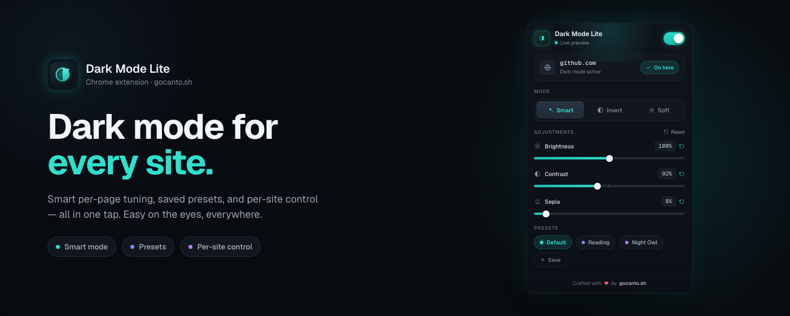

# Dark Mode — Lite

A compact browser extension and native macOS controller that add a real dark mode to sites
that don't ship one.

<p align="center">
  
</p>

## What it does

- **Global + per‑site toggle** — turn dark mode on everywhere, then keep a per‑site
  blocklist for pages you'd rather leave untouched.
- **Three modes**
  - **Smart** — analyzes each element and darkens only the light surfaces (best default).
  - **Invert** — flips the whole page, re‑inverting images/video/SVG so media looks right.
  - **Soft** — applies a gentle dark palette without scanning the DOM (fast, simple pages).
- **Fine‑tuning** — brightness, contrast, and sepia sliders, each with a one‑tap reset.
- **Presets** — built‑in *Default / Reading / Night Owl*, plus save your own.
- **Syncs** — settings persist to `chrome.storage.sync`, so they follow your Chrome profile.

## Why

Most dark‑mode extensions are either heavy (parsing every CSS rule, shipping site‑specific
fixes) or crude (a blunt `invert()` over everything). **Dark Mode Lite** aims for the middle:
small enough to read and audit in an afternoon, but smart enough to look good on real pages.
It's a compact, hackable extension — not a Dark Reader clone.

## Install

### From the Chrome Web Store

[**Add to Chrome**](https://chromewebstore.google.com/detail/oagcdogefhdjdgbfbgbjcjlpofbnappi) —
free, no account, no tracking. Packaging and the publish workflow are documented in
[docs/chrome-web-store.md](docs/chrome-web-store.md).

The store build ships only the extension itself — the popup, content script, icons, and
manifest. Marketing assets in [`storage/`](storage) are kept out of the packaged zip.

### From source

```bash
pnpm install
pnpm build      # emits the extension into dist/
```

Then load it in Chrome:

1. Open `chrome://extensions`
2. Enable **Developer mode**
3. **Load unpacked** → select the `apps/extension/dist/` folder

### Native macOS controller

On macOS 14 or newer, build and launch the Dockless menu-bar controller with:

```bash
make run
```

The app embeds its Safari WebExtension and pairs with the separately packaged Chrome and
Firefox companions. See [apps/macos/README.md](apps/macos/README.md) for local setup and
[docs/macos-release.md](docs/macos-release.md) for unsigned, Developer ID, and Mac App Store
distribution.

## How it works

Two independent pieces talk over Chrome's messaging APIs:

- **Popup** (`apps/extension/src/popup/`) — a Vue 3 + Tailwind 4 UI. State lives in a
  `PopupController` class that reads/writes settings and mirrors them to the active tab.
- **Content adapters** (`apps/extension/src/content.ts`, `controllerContent.ts`) — small
  browser-runtime adapters around the API-independent `DarkModeEngine`.
- **Native controller** (`apps/macos/`) — a Swift 6 menu-bar app that owns settings,
  browser pairing, tab selection, and the loopback protocol.

Both browser integrations share the same `SettingsCodec` and DOM engine. Stateful
TypeScript logic remains class-based; Vue single-file components and composables stay
idiomatic.

## Development

Requires **Node 24+** and **pnpm 11+**.

```bash
pnpm install        # install workspace dependencies
pnpm dev            # run the popup in a Vite+ dev server (preview mode)
pnpm build          # build the loadable extension into apps/extension/dist/
pnpm dev:web        # run the marketing site (VitePress) dev server
pnpm build:web      # build the marketing site into apps/web/.vitepress/dist/
pnpm test           # run unit/feature tests (Vitest, via Vite+)
pnpm typecheck      # vue-tsc type check across all packages
pnpm check          # paths + tests + typecheck + builds (run before pushing)
pnpm package:store  # build + validate + zip the Chrome Web Store package
pnpm package:controllers # package Chrome and Firefox companions
pnpm format-all     # format the whole tree
make run            # build and launch the native macOS controller
```

This is a **pnpm workspace monorepo**: the extension build uses **Vite+** (`vp`); the website
uses the **VitePress** engine with a custom theme layered on top. Root scripts delegate to the
relevant workspace package via `pnpm --filter`.

Releasing to the Chrome Web Store (packaging and the automated publish workflow) is
documented in [docs/chrome-web-store.md](docs/chrome-web-store.md).

`pnpm dev` runs the popup standalone (no extension runtime) at the server root (`/`), so it
renders in "Live preview" mode against default settings — handy for iterating on the UI.

### Project layout

```text
apps/
  extension/                     # @dml/extension — the MV3 Chrome extension (Vite+)
    index.html                   # popup entry (Vite+ root entry)
    public/
      manifest.json              # MV3 manifest (copied verbatim into dist/)
      icons/                     # extension icons (16/32/48/128)
    src/
      content.ts                 # Chrome extension content adapter
      content/DarkModeEngine.ts  # API-independent DOM engine
      controller*.ts             # native-controller WebExtension adapters
      types/settings.ts          # shared Settings model + SettingsCodec
      popup/
        App.vue                  # popup root
        components/              # UI (popup sections + shadcn-vue primitives)
        composables/PopupController/ # controller, runtime adapter, settings gateway
  controller-extension/          # Safari/Chromium/Firefox companion manifests
  macos/                         # Swift 6 menu-bar app + Safari extension + tests
  web/                           # @dml/web — the marketing site (VitePress, deploys to Cloudflare Pages)
    .vitepress/                  # VitePress config + custom theme entry
    src/                         # Layout, views, components, styles
    wrangler.jsonc               # Cloudflare Pages project
packages/
  ui/                            # @dml/ui — shared cn() util + Button primitive
  tsconfig/                      # @dml/tsconfig — shared TypeScript base config
scripts/                         # repo tooling (check-paths, format, package-store)
storage/                         # Chrome Web Store assets (screenshots, promo art) — not shipped
```

## Contributing

1. Branch off `main` (or fork).
2. Make your change and keep it covered by tests where it matters.
3. Before pushing, run:
   ```bash
   pnpm check
   pnpm format-all
   ```
4. Use clear, conventional commit messages (`feat:`, `fix:`, `refactor:`, `chore:`) and
   split work by concern.
5. Open a PR.

Conventions worth knowing:

- **TypeScript** follows `.agents/skills/typescript-coding-standards`.
- **Imports** use repo path aliases (`@popup`, `@components`, `@composables`, `@lib`, `@/…`) —
  never `./` or `../` (see `.agents/skills/no-relative-module-specifiers`).
- CI details (labels, coverage gates, E2E) live in `AGENTS.md`.

## License

[MIT](LICENSE).

## Author

Built by **[gocanto.sh](https://gocanto.sh)** ❤️
